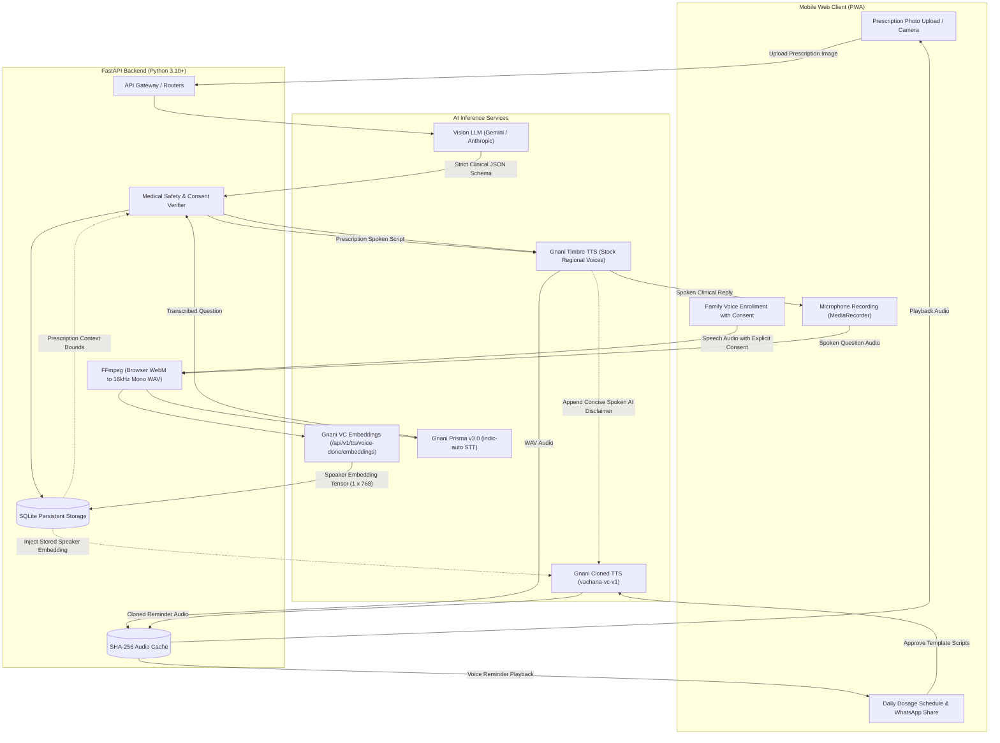

# Dawai Saathi (दवाई साथी / మందుల సహచరి)
> **Voice-First Medicine Companion for Rural and Elderly Patients**  
> Built for the Gnani AI Hackathon

[](https://daawai-saathi.onrender.com/)
[](SOLUTION_PITCH.md)
[](https://fastapi.tiangolo.com)
[](https://vachana.ai)
[](https://python.org)
[](LICENSE)

---

### Access Points
* **Live Production Application:** [Dawai Saathi | दवाई साथी | మందుల సహచరి](https://daawai-saathi.onrender.com/)
* **One-Page Solution Pitch:** [SOLUTION_PITCH.md](SOLUTION_PITCH.md)
* **Demo Video Script (3-Minute Walkthrough):** [DEMO.md](DEMO.md)
* **GitHub Repository:** [https://github.com/Rahul-14507/Daawai_saathi](https://github.com/Rahul-14507/Daawai_saathi)

---

## 1. Executive Summary & Problem Statement

In rural and semi-urban India, **over 65% of patients cannot read handwritten English prescriptions**. Elderly patients frequently confuse morning and evening dosages, terminate antibiotic courses prematurely, or overlook critical food instructions (such as taking proton-pump inhibitors on an empty stomach).

Simultaneously, their adult children often work in metropolitan centers (Bengaluru, Hyderabad, Mumbai, Delhi) and face ongoing anxiety regarding their parents' medication adherence. Generic alarm applications rely on text-heavy English interfaces and clinical beeps that fail to drive behavioral compliance.

Dawai Saathi solves this problem through an empathetic, voice-first regional architecture:
1. **Prescription to Regional Speech**: Analyzes handwritten prescriptions and diagnostic reports, synthesizing clear, conversational medical explanations in 10 Indian languages via **Gnani Timbre v2.5**.
2. **Family Voice-Cloned Dose Reminders**: With affirmative legal consent, a family member records 10-20 seconds of speech. Dawai Saathi leverages **Gnani Vachana Neural Voice Cloning (`vachana-vc-v1`)** to synthesize daily dosage reminders in that specific relative's voice (e.g., *"Amma, take your Pantoprazole before breakfast"*).
3. **Prescription-Bounded Voice Q&A**: Elderly patients can ask questions aloud in their mother tongue or code-mixed dialects (Hinglish/Tanglish). Dawai Saathi transcribes input via **Gnani Prisma v3.0 STT** and generates answers bounded strictly to the attending physician's written instructions.

---

## 2. Architecture & Data Flow



---

## 3. Gnani AI Model Integration

| Capability | Gnani API Endpoint | Model / Architecture | Usage in Dawai Saathi |
| :--- | :--- | :--- | :--- |
| **Stock Voice TTS** | `POST https://api.vachana.ai/api/v1/tts/inference` | `timbre-v2.5` & `timbre-v3.0`<br>Voices: `Suhana` (te-IN), `Chitra` (hi-IN), `Asmita` (ta-IN), `Chetana` (all 10 languages) | Synthesizes prescription summaries and Q&A responses in native regional cadence. |
| **Voice Clone Embeddings** | `POST https://api.vachana.ai/api/v1/tts/voice-clone/embeddings` | Neural Speaker Encoder (`multipart/form-data`) | Extracts a 768-dimensional speaker acoustic embedding tensor (`torch.bfloat16`) from reference audio. |
| **Voice-Cloned TTS** | `POST https://api.vachana.ai/api/v1/tts/inference` | `vachana-vc-v1`<br>Payload: `speaker_embedding` | Synthesizes doctor-approved reminder templates in the enrolled family member's voice. |
| **Speech-to-Text (STT)** | `POST https://api.vachana.ai/stt/v3` | `prisma-v3.0`<br>`language_code: indic-auto` | Transcribes patient voice questions with automatic language detection and code-mixing support. |

### Concurrency and Rate-Limit Control
Requests to the Gnani inference endpoints are managed via thread-safe mutex locks to respect single-stream concurrency limits and eliminate HTTP 429 status codes. All synthesized speech segments are content-addressed and cached locally via `SHA256(text + voice + language)` to reduce unnecessary API overhead and preserve credits.

---

## 4. Medical Safety & Responsible AI Framework

1. **Deterministic Prescription Bounding**:
   - The clinical vision extraction engine is strictly bounded to the doctor's handwriting. Speculative diagnostics or medication alterations are prohibited.
   - Ambiguous line items or low-confidence readings are automatically isolated into an amber **"Please Confirm with Pharmacist"** review panel.
   - Identified emergency indicators (such as high fever, severe breathlessness, or drug contraindications) trigger a red urgent medical referral alert.

2. **Cloned Voice Boundaries**:
   - Cloned family voices are **never** permitted to speak free-form clinical diagnoses. Stock regional voices are mandated for clinical explanations.
   - Cloned family voices exclusively speak bounded, pre-approved dosage templates (e.g., *"{Call_name}, it is time for your {slot} medication. Take {Medicine} after meals with plenty of water."*).
   - Redundant repetitive greetings are programmatically removed so intros are spoken once per schedule slot.
   - Every synthesized voice reminder automatically appends a concise regional safety tag at the conclusion of the audio (*"AI Reminder / ఏఐ రిమైండర్"*).

3. **Explicit Consent & Data Autonomy**:
   - Family voice enrollment requires explicit affirmative consent recorded via mandatory checkbox verification.
   - Acoustic voice embeddings are stored in isolated local tables with audit timestamps and can be permanently purged on demand via the deletion interface.

---

## 5. Technical Specifications & Local Deployment

### System Prerequisites
- Python 3.10 or higher
- FFmpeg installed and available on system PATH
- Active Gnani AI API Key

### Installation Steps

1. **Clone the Repository**:
   ```bash
   git clone https://github.com/Rahul-14507/Daawai_saathi.git
   cd Daawai_saathi
   python -m pip install -r requirements.txt
   ```

2. **Configure Environment Variables**:
   Copy `.env.example` to `.env`:
   ```bash
   cp .env.example .env
   ```
   Provide valid API credentials:
   ```ini
   GNANI_API_KEY=your_gnani_api_key_here
   LLM_PROVIDER=gemini
   LLM_API_KEY=your_gemini_api_key_here
   LLM_MODEL=gemini-2.5-flash
   HOST=0.0.0.0
   PORT=8000
   ```

3. **Run Verification Tests**:
   ```bash
   python scripts/smoke_test.py
   ```
   *Validates Stock TTS, Voice Clone Embeddings, Cloned TTS, and Prisma STT against live Gnani endpoints.*

4. **Launch the Service**:
   ```bash
   uvicorn backend.main:app --host 0.0.0.0 --port 8000
   ```
   Navigate to `http://localhost:8000` in any web or mobile browser.

---

## 6. Containerized Deployment

### Docker Deployment
```bash
docker build -t dawai-saathi .
docker run -p 8000:8000 --env-file .env dawai-saathi
```

### Production Hosting (Render / Cloud Platform)
The repository includes automated Dockerfile configurations compatible with cloud container runners:
1. Link repository to Render / Railway.
2. Select Environment: **Docker**.
3. Supply required environment variables: `GNANI_API_KEY`, `LLM_API_KEY`, `LLM_PROVIDER`.
4. The application automatically binds the dynamically allocated `$PORT` and serves production traffic.

---

## 7. Progressive Web Application (PWA) Capabilities

Dawai Saathi is architected as an installable Progressive Web Application:
- **Standalone Execution:** Operates without browser chrome when added to mobile home screens.
- **Service Worker (`sw.js`):** Intercepts static assets to ensure reliable loading in low-connectivity rural environments.
- **Accurate Audio Scrubber:** Employs a custom HTML5 audio management engine to eliminate Chromium's duration metadata calculation defect on WebM media blobs.
- **Visual Multi-Stage Indicators:** Provides live percentage and stage feedback during voice embedding extraction and dosage audio synthesis.

---

## 8. License & Medical Disclaimer

This software is released under the **MIT License**.

**Medical Disclaimer**:  
*Dawai Saathi is a health-literacy and medication-adherence assistive tool. It is engineered to transcribe, translate, and remind patients of valid instructions issued by licensed healthcare professionals. It does not provide medical diagnosis, prescribe treatments, or substitute professional clinical judgment.*
